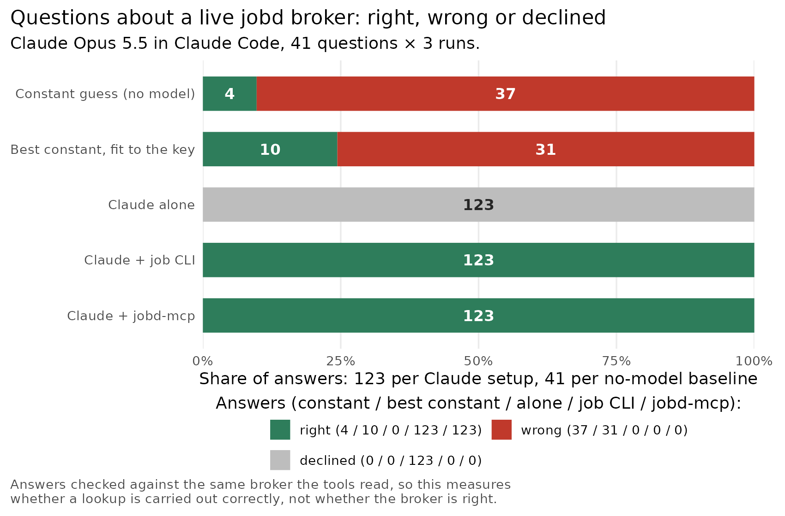
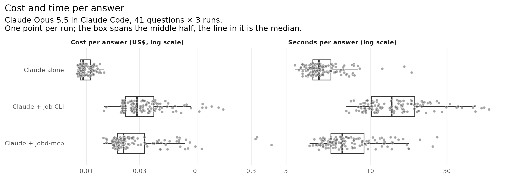
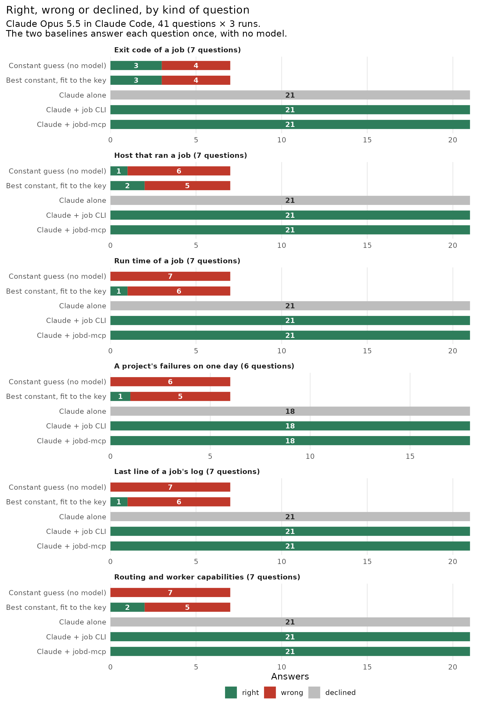

# Agent benchmark: questions about a live broker, with and without jobd-mcp

We asked Claude Opus 5.5 41 read-only questions about a live jobd broker,
3 times each, with no tools, with the `job` CLI, and with jobd-mcp. Both tool
setups got every question right in every run, so accuracy does not separate
them (exact McNemar test, 0 discordant questions, p = 1). With the server the
median answer took 6.7 s against 13.6 s, a ratio of 0.49 (95% CI 0.44 to
0.59), and used 1.1 fewer tool calls on average (0.8 to 1.5). Its median cost
was lower, a ratio of 0.76 (0.67 to 0.81), but its mean cost was the same,
1.00 (0.78 to 1.31), because one question cost 2 to 3 times as much with the
server. The main limitation is the ceiling: the questions are too easy to
rank the two setups on accuracy.



## Results

| Setup | Right | Wrong | Declined | Invalid | Questions right in all 3 runs | Cost / answer, median (mean) | Seconds / answer, median (mean) | Tool calls / answer, median (mean) |
|---|---|---|---|---|---|---|---|---|
| Constant guess, no model (1 answer per question) | 4 | 37 | 0 | 0 | 4 of 41 | – | – | – |
| Best constant, fit to the key, no model (1 per question) | 10 | 31 | 0 | 0 | 10 of 41 | – | – | – |
| Claude alone | 0 | 0 | 123 | 0 | 0 of 41 | $0.009 ($0.010) | 4.8 (5.4) | 0 (0) |
| Claude + job CLI | 123 | 0 | 0 | 0 | 41 of 41 | $0.028 ($0.038) | 13.6 (16.4) | 2 (2.9) |
| Claude + jobd-mcp | 123 | 0 | 0 | 0 | 41 of 41 | $0.022 ($0.038) | 6.7 (8.2) | 1 (1.8) |

Counts are out of 123 answers per Claude setup and 41 per baseline. A
question's three runs are not independent, so the questions column is the
fairer count. The table comes from [`summary.tsv`](summary.tsv) and the tests
from [`stats.tsv`](stats.tsv). Intervals are 95% bootstrap intervals over the
41 questions (10,000 draws, seed 20261016), resampling a question's three runs
together.

Per question, on the median of its three runs, the server against the CLI:

- Time: 6.7 s (6.1 to 7.7) against 13.6 s (11.2 to 15.8). The server was
  faster on all 41 questions (sign test p = 9e-13).
- Tool calls: fewer on 37 questions, more on 3, 1 tie (p = 2e-8). Every one
  of the 123 CLI runs started by reading `job --help`.
- Cost: cheaper on 35 questions, more expensive on 6 (p = 5e-6). Total cost
  was $4.66 for the server's 123 answers and $4.65 for the CLI's.

Mean cost is equal while median cost is not because of q26, which asks for
every failed job of one project on one day. It cost $0.33 to $0.46 per run
with the server and $0.13 to $0.17 with the CLI. `jobd_list` rows carry no
`finished_at` and the tool has no date filter, so Claude fetched all 194 of
the project's failures (41,808 characters as Claude received them), then
`job_completed` events since a chosen date (up to 47,795 characters) to find
the day. With the CLI it ran `job status` for each job and grepped the
`finished` line.

The
server's 5 `jobd_submit` calls were all dry runs, for routing questions; the
CLI has no dry run, so it answered those from the tags `job workers` prints.
The slowest single answers took 18 s (alone), 55 s (CLI) and 26 s (server).





## Controls

`analyze.py` applies these after a sweep, with no model and no broker. Tests:
`tests/test_agent_qa_controls.py`.

- Oracle: before a sweep, `run.py` stops unless every key answer, formatted
  as a reply, scores right, and a near miss for every question scores wrong
  (exit code + 1, another host, run time + 3 s, one extra job id, the log line
  with text appended, one extra worker). On the real key, 41 of 41 scored
  right and 41 of 41 near misses scored wrong. CI runs the same check on a
  synthetic key (100% and 0%) and checks that it stops a scorer that is too
  lenient or too strict.
- Baselines: two rows with no model, scored by the same `score.py`. The
  constant guess is fixed without the key: exit code 0, the busiest worker
  (3,305 of 6,001 finished jobs), the median run time (144 s), no failures,
  "Done." as the last log line, and every online worker. It gets 4 of 41
  (3 exit codes, 1 host). The best constant takes, per kind, the key's most
  common answer. It is a ceiling on any constant rather than a usable
  strategy, and gets 10 of 41 (3 exit codes, 2 hosts, 2 worker sets, and 1
  each of run time, failures and log line).
- Validity: one rule for every setup. A run counts only if it exited 0 with a
  result, the init event listed exactly that setup's tools (none, `Bash`, or
  the jobd server's six read tools, never a mutating one), a setup with tools
  made at least one call (no model can know a job's exit code), and the leak
  scan found nothing. Nothing is retried; a timeout or harness error would
  stay in as an invalid run. All 369 runs were valid, 0 invalid in each setup
  ([`validity.tsv`](validity.tsv)), and the read-only proxy refused no
  request.
- Leak scan: every tool input, tool output and proxied request path in all
  369 transcripts is searched for the key and result file names, this
  benchmark's directory (locally or on GitHub, including
  raw.githubusercontent.com), this repo's worktrees, and the pilot and run
  directories. Hits: 0. Other repos' worktree paths are not counted, because
  jobs ran there and their records name them.

## Limitations

- The key comes from the broker the tools read, so we measure whether a
  lookup is carried out correctly. We do not measure whether the broker is
  right.
- Both tool setups got everything right, so the questions cannot rank them on
  accuracy. Harder questions (several lookups, judgment) might.
- The questions come from one broker: four workers and about 6,700 jobs.
  Another fleet's history may be easier or harder to search.
- The questions are read-only. Nothing is submitted, cancelled or preempted,
  so the benchmark says nothing about doing those well.
- One model, one date.

## Method

### Setups

Each run is a separate `claude -p` with Claude Opus 5.5:

- Claude alone: no tools.
- Claude + job CLI: Bash, allowed to run only `job` and a few read-only text
  tools (`grep`, `jq`, `date`, …) to filter its output. This is what a user
  has without the server.
- Claude + jobd-mcp: the server only, without `jobd_cancel`, `jobd_preempt`
  and `jobd_worker_delete`.

Every run gets `--setting-sources ""`, an empty working directory,
`--strict-mcp-config` (no other MCP servers) and the same short system
prompt. The user prompt names the client `job` in every setup.

### Questions

`build_questions.py` draws 41 questions at random (seed 20261016) from the
broker's job history and fleet and freezes the answers in `questions.json`.
That file names the broker owner's projects, jobs and log lines, so it is kept
outside the repo with the results and transcripts
(`~/jobd-artifacts/agent_qa/`, or `$JOBD_QA_ARTIFACTS`).

| Kind | Count | Answer key |
|---|---|---|
| Exit code of a job (3 completed, 4 failed) | 7 | `GET /jobs/{id}` |
| Host that ran a job | 7 | `GET /jobs/{id}`, plus the host's own aliases from `GET /workers` |
| Run time of a job (one per seventh of the duration distribution) | 7 | `finished_at - started_at` |
| Every failed job of one project on one UTC day | 6 | `GET /jobs?state_filter=failed`, filtered by the builder |
| Last non-empty line of a job's log | 7 | `GET /jobs/{id}/output` |
| Which workers a job with given tags could run on, the largest GPU tier, the most job slots | 7 | `GET /workers`, cross-checked against a dry-run `POST /submit` |

The builder reads the broker's HTTP API over httpx and never imports `jobd`,
so a bug in jobd-mcp or its client cannot also be in the key. It uses only
jobs that reached a terminal state more than an hour before the freeze, so
their fields cannot change. Logs and worker configuration can still go stale,
so `run.py` re-reads the broker before a sweep and stops if either has. Logs
are pruned after about 60 days, so log questions use jobs from the last 21
days. Projects whose names fold together (`Foo`/`foo`, `a-b`/`a_b`) are left
out, because the broker's project filter matches the folded name.

### Scoring

Each reply ends with `ANSWER: <value>` or `ANSWER: UNKNOWN`, and `score.py`
reads only that line: right, wrong, declined (`UNKNOWN`) or no answer. `NONE`
("no job failed") is a claim, so it is scored as a value. Exit codes must be
equal, sign included (jobd records a SIGTERM as -15). Hosts match any name the
host goes by, case ignored. Run times are right within 1 second; every surface
shows timestamps to the microsecond, so rounding moves an honest answer by
less than that. Failed-job lists and worker sets must be the exact set, with
aliases read as their host. Log lines must be equal after trimming,
collapsing whitespace and removing quotes around the whole line, with case
counted. A wrong host or worker answer naming no host the broker has ever known is
also flagged `unknown_host`, checked against its host list. Tests:
`tests/test_agent_qa_score.py`.

### Safety

The broker runs real work, so no setup can change anything on it. Every setup
reaches it only through `readonly_proxy.py`, a loopback proxy started for each
run. It holds the token and passes only GETs (except `/gpu-holders`),
`POST /submit` with `"dry_run": true`, `POST /resolve` and `POST /classify`;
anything else gets a 403. The token is removed from the setup's environment,
so a request that skips the proxy gets a 401. The CLI setup's `job` is
`job_guard.py`, run from a copy in the run's temp directory: it allows only
read-only subcommands, runs `submit` only as `submit --explain`, and points
the real CLI at the proxy without the token. `--disallowedTools` also names
the mutating MCP tools and `job` subcommands, and `run.py` stops the sweep if
a `job` command that talks to the broker leaves no trace in the proxy log.
`tests/test_agent_qa_guards.py` runs the real CLI through the guard and proxy
against a fake broker and checks, in the same test, that mutating commands
are refused and read-only ones go through.

### Versions

`job` from `jobd==0.5.51` and `jobd-mcp` from `jobd[mcp]==0.5.51`, both from
PyPI through `uvx`. The broker ran 0.5.51 on all four workers. Claude Code
2.1.302, model `claude-opus-5-5`, recorded per run. Before a sweep, `run.py`
stops unless the broker's `/health` version is the one the key was built on
(answers depend on its routing and terminal-state rules) and both pinned
packages report 0.5.51.

The sweep ran on 2026-10-16 (US Eastern) and cost $10.52 in API usage.
Transcripts and proxy logs are kept in `runs/` in the artifacts directory.

## History

1. Pilot 1 (q04 and q35, 1 run each): alone declined both, the server got
   both right, and the CLI setup looked for `jobd` (the server binary), was
   denied, and declined both. Fix: every prompt names `job`, and the `jobd`
   binaries are denied by name.
2. Pilot 2: the CLI setup got both right, but the proxy logged nothing,
   because the Bash tool's zsh re-read `~/.zshenv` and picked up the live
   broker's address and token. Every command was read-only and still
   filtered by the guard. Fix: the guard forces the proxy address and drops
   the token, the setup gets an empty `ZDOTDIR`, and `run.py` stops if the
   proxy sees nothing. Pilot 1 and 2 transcripts were deleted; their verdicts
   are given here.
3. Pilot 3: all 6 runs as expected, every CLI request in the proxy log. Rows
   kept locally in `~/jobd-artifacts/agent_qa/pilot/`, since they quote
   broker data.
4. Before the sweep: `NONE` became a value instead of a decline, and the guard
   stopped accepting `--explain` placed after `--`, where the CLI passes it to
   the job.
5. The sweep: 369 runs, once, no reruns.
6. Controls (PR #162): baselines, oracle, validity rule, leak scan, statistics
   and version checks; artifacts moved out of the checkout. Rescoring all 369
   replies changed no verdict. The first leak scan also counted other repos'
   worktree paths and flagged 36 runs, all because jobs had run there.

## Reproduce

```bash
export JOBD_URL=... JOBD_API_TOKEN=...                          # the broker to ask about
uv run python benchmarks/agent_qa/build_questions.py             # freeze the key (~/jobd-artifacts/agent_qa/questions.json)
uv run python benchmarks/agent_qa/run.py --reps 3 --workers 1    # oracle + version checks, then 369 claude -p runs; resumable
uv run python benchmarks/agent_qa/run.py --rescore               # re-score stored replies after a key fix
uv run python benchmarks/agent_qa/analyze.py                     # validity, leak scan, baselines, stats.tsv
Rscript benchmarks/agent_qa/plot.R                               # summary.tsv + figures
```
